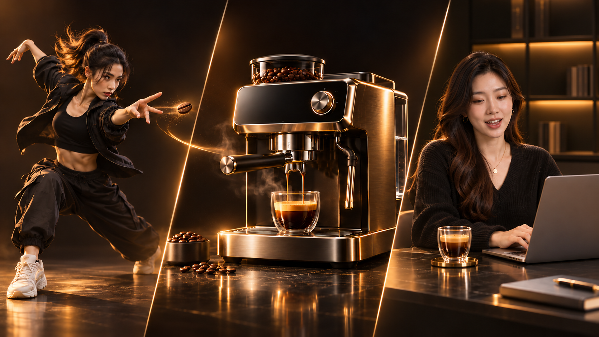

# 咖啡机新创意：一颗豆，切换状态



> 这是玩法六的**静态概念效果图**，用来预览“功夫女孩 → 咖啡豆 → 指定咖啡机 → 办公女士”的视觉关系。它不是 Seedance 视频截图，也不作为下方视频任务的参考素材上传。图中人物与产品细节仍需以用户提供的原图为准。

## 素材输入与执行假设

| 提示词编号 | 下载／保存文件名 | 只继承 | 不继承 |
|---|---|---|---|
| `@图片1` | [图片1-办公女士原图.png](参考图-图片1至图片8/图片1-办公女士原图.png) | 人脸、长深色头发、金色耳环、黑色针织衫 | 背景中另一款咖啡机、拿铁陶瓷杯、领口麦克风、原场景 |
| `@图片2` | [图片2-功夫女孩原图.png](参考图-图片1至图片8/图片2-功夫女孩原图.png) | 人脸、马尾、黑色运动装、白色运动鞋、动作气质 | 单张静态姿态不是完整动作轨迹 |
| `@图片3` | [图片3-咖啡机产品原图.png](参考图-图片1至图片8/图片3-咖啡机产品原图.png) | 咖啡机可见的外观与结构 | 原暗色棚拍背景、未见结构、未经确认的功能 |
| `@图片4` | [图片4-办公室空场景.png](参考图-图片1至图片8/图片4-办公室空场景.png) | 同一空间里的咖啡角、办公桌与光线 | 其他产品、人物、杯子 |
| `@图片5` | [图片5-单颗咖啡豆.png](参考图-图片1至图片8/图片5-单颗咖啡豆.png) | 咖啡豆形状、颜色、微距构图，辅助匹配切 | 任何机器功能或魔法般的跨空间运动 |
| `@图片6` | [图片6-女士接咖啡.png](参考图-图片1至图片8/图片6-女士接咖啡.png) | 办公女士、指定机器和玻璃杯在咖啡角的相对位置 | 图中局部机器细节不能覆盖 `@图片3` 的真实产品外观 |
| `@图片7` | [图片7-女士办公桌.png](参考图-图片1至图片8/图片7-女士办公桌.png) | 同一女士、同一办公室和玻璃杯在 Logo 前的工作状态 | 图中局部机器细节不能覆盖 `@图片3` 的真实产品外观 |
| `@图片8` | [图片8-AURBREW品牌收尾参考.png](参考图-图片1至图片8/图片8-AURBREW品牌收尾参考.png) | 22–24 秒全屏收尾卡的完整画面依据 | 候选品牌概念，不能当作已注册或已确认的正式 Logo |

下载时保留表中的 `图片N-用途.png` 文件名；提示词里的 `@图片N` 对应同一编号。`图片1` 至 `图片3` 已从本次对话的原始上传数据恢复，未用效果预览图或生成图替代。若浏览器下载后改名，按本表核对再上传。

[一键下载全部八张编号参考图](参考图-图片1至图片8.zip)。压缩包内仅有 `图片1` 至 `图片8`，不含玩法效果预览图。

用户提出的故事方向已明确。暂定输出为 24 秒、16:9、Seedance 2.5 全模态参考生视频；声音为器乐和动作音效，无对白、旁白或字幕。品牌收尾仅使用 `@图片8` 中已有的英文标识；实际平台的素材标记和设置需按其界面替换。

**候选品牌名：**AURBREW，取金色光感与 coffee brewing 的组合，配合机器的黑金视觉。此名与收尾图仅供创意演示；正式使用前需由品牌方确认名称、商标和可用素材。

**玩法定位：**八大玩法中的第六种“场景参考＋详细分镜”，表达方式是咖啡豆匹配切与办公室生活方式叙事。当前没有功夫动作视频，因此不把静态人物图称作动作迁移素材。

## 创意与分镜

**故事概念：**功夫女孩的一次出手，将“动势”交给一颗咖啡豆；咖啡豆填满镜头后，匹配切到办公空间咖啡机顶部的豆仓。办公女士使用指定咖啡机接一杯咖啡，带到办公桌前开始工作；最后以 AURBREW 候选品牌图形全屏收尾。故事不声称咖啡提升工作效率。

| 时间 | 画面与结束状态 | 主参考 | 声音 |
|---|---|---|---|
| 0–3 秒 | 暗色棚拍中功夫女孩进入稳定姿态，右手指尖夹一颗豆 | `@图片2`、`@图片5` | 低节奏鼓点、衣料声 |
| 3–7 秒 | 她完成一组短促流畅的转身与挥臂，弹出**一颗**豆；豆子靠近镜头直至遮满画面 | `@图片2`、`@图片5` | 挥臂声、豆子掠过声 |
| 7–9 秒 | 豆子遮挡画面处硬切，成为 `@图片3` 咖啡机透明豆仓中的一颗豆；镜头揭示整机在 `@图片4` 办公咖啡角 | `@图片3`、`@图片4`、`@图片5` | 一声轻脆落豆音，音乐转暖 |
| 9–15 秒 | 女士将透明双层玻璃杯放在双出液口下；镜头切到两股咖啡液落杯；液流停后她拿起同一杯 | `@图片1`、`@图片3`、`@图片4`、`@图片6` | 咖啡流动声 |
| 15–20 秒 | 女士从同一办公室咖啡角走到相邻办公桌坐下，手里始终是同一杯 | `@图片1`、`@图片4`、`@图片6`、`@图片7` | 脚步、衣料声 |
| 20–22 秒 | 她把杯子放在电脑旁，开始工作，形成清晰的办公桌画面 | `@图片1`、`@图片4`、`@图片7` | 杯底轻触、键盘声 |
| 22–24 秒 | 画面切到深色纯净背景；AURBREW 候选标识居中，独占全屏收尾卡 | `@图片8` | 音乐短尾收束 |

**关键转场：**7 秒处是“豆子遮满镜头 → 相近构图的豆仓特写”的**剪辑匹配切**，不是豆子跨越空间飞进机器。办公场景应是一个连贯空间，咖啡角与办公桌相邻。

## 效果图复现提示词

输入三张用户图，分别指定为办公女士身份、功夫女孩身份、唯一产品外观。生成一张 16:9 三场景并置的摄影风格预览图：左侧功夫女孩在黑金影棚中挥臂弹出单颗咖啡豆；中间是用户提供的黑面板暖金属咖啡机，双股咖啡液落入透明玻璃杯；右侧是同一办公女士在办公室桌前使用笔记本电脑，旁边放着同一类型的透明玻璃杯。三场景以暖金光线连接，人物面容和服装分别遵循各自照片，机器只能遵循产品照片。不要继承办公女士原图背景里的另一款机器、领口麦克风或陶瓷拿铁杯。无文字、Logo、水印或额外人物。这是静态概念预览，不是真实视频帧。

## 已生成参考图与复现提示词

以下五张图现已制作，直接使用上表的同名链接下载并上传。提示词保留用于以后重新生成或修改，不需要再从零制作。

### `@图片4` 空办公室空间参考图

```text
以办公女士原图的暖色材质和产品图的黑金色彩为参考，生成一张 16:9 写实商业摄影风格的现代办公室空场景。后方左侧是石材咖啡角台面，前方右侧是有笔记本电脑的办公桌；两处相距几步，中间有可行走路径。左侧窗户射入暖金晨光。咖啡角台面上方保持足够高度，不设低矮吊柜，确保放得下完整咖啡机及顶部豆仓；台面左侧为手柄留出空间。不要出现人物、咖啡机、其他电器、杯子、可读文字、Logo 或水印。
```

### `@图片5` 单颗咖啡豆匹配切参考图

```text
生成一张 16:9 高写实微距摄影参考图：只有一颗真实烘焙咖啡豆，深棕色，表面纹理清晰，位于画面中央，背景是深黑到暖棕的柔和渐变，左侧有一条克制的暖金边缘光。咖啡豆向镜头呈三分之二侧面，轮廓完整，适合在视频中从小变大并遮住镜头。不要出现第二颗豆、手、咖啡机、杯子、文字、Logo、水印、火焰或魔法粒子。
```

### `@图片6` 办公女士接咖啡关键画面

```text
同时参考办公女士原图、指定咖啡机原图和 @图片4 空办公室场景，生成 16:9 写实商业摄影关键画面。女士保持原图的面容、长深色头发、金色耳环与黑色针织衫，站在办公室左侧咖啡角；指定咖啡机完整放在空台面上，黑面板、暖金属机身、顶部透明豆仓、右上旋钮、左伸手柄、右侧蒸汽棒与水箱、双出液口均保持产品原图结构。女士将唯一一只透明双层玻璃杯放在双出液口下，右侧办公桌与笔记本电脑仍在同一空间可见。不要继承女士原图里的另一款机器、领口麦克风或陶瓷拿铁杯。不要新增机器、杯子、控制按钮、文字或 Logo。
```

### `@图片7` 办公桌工作关键画面

```text
以 @图片6 为同一空间、人物与产品的连续性依据，将同一办公女士从咖啡角移到右侧办公桌前坐下，保持脸、发型、耳环、黑色针织衫与深色长裤一致。唯一一只透明双层玻璃杯现在装有咖啡，放在笔记本电脑旁；咖啡机留在左侧原来的咖啡角，出液口下不再留杯子。保持左侧窗户、深色石材背景、台面、办公桌、暖金晨光与机器位置不变。女士自然地开始使用键盘。单一连续画面，不要第二人、第二台机器、第二只杯子、陶瓷杯、麦克风、文字、Logo 或水印。
```

### `@图片8` 英文候选品牌收尾图

已生成 [AURBREW 黑金收尾图](参考图-图片1至图片8/图片8-AURBREW品牌收尾参考.png)，完整画面可作最后两秒的参考。复现提示词：生成一张 16:9 全屏深黑背景的高级咖啡机品牌收尾卡，仅居中显示英文大写字样 `AURBREW`，七个字母拼写完全准确；左侧是单颗咖啡豆与上升弧线组成的简洁暖金图形。文字、图形保持正面平视和清晰边缘；不出现机器、人物、杯子、其他文字、标语或水印。品牌名仍是候选；若后续确定正式 Logo，需用正式原文件替换本图。模型若无法准确保留字形，应把原图作为后期末帧叠加。

## 一次生成的完整 Seedance 主提示词

> 使用 Seedance 2.5 的 24 秒参考生视频任务作首轮测试，上传 8 张编号参考图；截至 2026-11-16，[官方 2.5 教程](https://docs.volcengine.com/docs/ark/seedance-2-5?lang=zh)列出的单次时长和图片数量可覆盖这一规格。实际提交仍以所用界面为准。人物参考图涉及写实人脸，须先按[平台肖像素材规则](https://docs.volcengine.com/docs/ark/video-generation-tutorial?lang=zh)确认可用路径。`@图片8` 是 AURBREW 候选品牌收尾图，并非已确认商标；精确 Logo 建议在末帧使用原图叠加。

```text
【玩法】玩法六：场景参考＋详细分镜｜功夫女孩弹出一颗咖啡豆，以豆子遮挡镜头匹配切到咖啡机，再转入办公场景｜多素材参考生成新视频，非编辑或延长
Seedance 2.5｜24秒｜16:9｜写实商业广告｜无对白、无旁白、无字幕｜器乐配乐＋现场音效

【创作目标】以一颗咖啡豆把动作影棚与同一间现代办公室连接起来：功夫女孩出手，豆面遮挡转场，指定咖啡机出液，办公女士端杯到桌前工作，最后切全屏英文品牌卡。故事以画面动作推进，不暗示咖啡提升工作效率。

【素材说明与优先级】
@图片3 是唯一咖啡机外观依据，优先级最高：黑色正面面板、暖金属色机身、顶部透明豆仓、正面右上旋钮、向左伸出的手柄、右侧蒸汽棒和水箱、双出液口。只继承机器外观，不继承原图的黑色背景、玻璃杯液面或正在出液的时间状态。
@图片1 定义办公女士 B：只锁定她的脸、长深色头发、金色耳环和黑色针织衫；不继承照片背景里另一款咖啡机、陶瓷拿铁杯或领口麦克风。
@图片2 定义功夫女孩 A：只锁定她的脸、高马尾、黑色运动装和白色运动鞋；照片仅提供外观与起始姿态，不代表完整动作视频。
@图片4 只锁定办公室布局：左侧窗户与咖啡角、右侧办公桌、两处之间的行走路线和晨光方向。
@图片5 只锁定单颗咖啡豆的外观与微距构图，用于遮挡式匹配切。
@图片6 只参考办公女士、指定机器和一只透明双层玻璃杯在咖啡角的站位；不继承其中的出液时间状态，产品细节服从产品原图，人物身份服从办公女士原图。
@图片7 只参考办公女士坐在右侧桌前、玻璃杯在电脑旁、机器留在左侧咖啡角的结束构图；产品细节服从产品原图，人物身份服从办公女士原图。
@图片8 是 22–24 秒 AURBREW 候选品牌收尾卡的完整画面依据；保持原图字样 AURBREW 的七个字母、图形、颜色和比例，不生成额外品牌文字。

【人物、产品与空间锁定】
功夫女孩 A 和办公女士 B 是两位不同的人；A 只出现在动作影棚，B 只出现在办公室。全片只有一台指定咖啡机、同一只透明双层玻璃杯。机器始终在办公室左侧咖啡角，手柄朝画面左侧；办公桌始终在右侧，窗光从左侧进入。杯子先在双出液口下方，出液停止后由 B 拿到办公桌；机器下方不再留下第二只杯子。

【统一摄影风格】
开场是深黑背景、暖金边缘光的写实动作摄影；豆子匹配切后进入已绑定的办公室，延续暖金色调与自然晨光。镜头切换清楚，每个镜头只用一个主要运镜。22 秒切入深色纯净品牌收尾卡，不叠在办公室画面上。全程不要三分屏或拼贴画面。

【时间轴】
0–3秒｜功夫女孩 @图片2 在暗色场景中站稳，右手指尖夹一颗与 @图片5 一致的咖啡豆；中景缓慢靠近，她的视线落在豆子上。
3–7秒｜她完成一次短促、流畅的旋身与挥臂，指尖弹出这一颗豆；镜头跟随豆子靠近，豆子逐渐放大并完全遮住画面。末帧只有深棕色豆面。
7–9秒｜在遮挡处硬切到相近构图：同样一颗豆现在位于 @图片3 咖啡机的透明豆仓中。镜头扩大景别，露出放在 @图片4 左侧咖啡角的完整咖啡机。这是剪辑匹配切，不表现豆子跨空间飞行。
9–11秒｜办公女士 B 进入咖啡角，参考 @图片6 的站位，将唯一的透明双层玻璃杯放到两个出液口正下方；中景定住，不拍未经确认的按钮操作。
11–13秒｜切固定近景，两股咖啡液准确落入同一只杯子，液面自然升高；机器结构始终服从产品原图。
13–15秒｜液流先停止，B 再拿起这只杯子并转向右侧办公桌；出液口下方不留下另一只杯。
15–20秒｜女士手持同一杯咖啡，沿 @图片4 的通道从左侧咖啡角走到右侧办公桌并坐下。镜头平稳跟随，人物、杯子、机器和空间方向连续。
20–22秒｜她将杯子放在笔记本电脑旁，开始自然地使用键盘；镜头从侧前方中景轻微靠近，形成 @图片7 所示的办公桌画面，咖啡机仍在左侧远处。
22–24秒｜干净切到 @图片8 的全屏深色候选品牌收尾卡。画面仅保留清晰居中的 AURBREW 英文字样与左侧咖啡豆弧线图形，完整保持参考图的布局、拼写、颜色和比例，静止至结束；不出现人物、机器或额外文字。

【声音】
开场为克制鼓点、衣料挥动声与单颗豆子的掠过声；豆子匹配切处一声轻脆落豆声。办公室段转为低音量暖调器乐，咖啡流动、脚步、杯底轻触与键盘声分别和动作同步。Logo 收尾卡只保留音乐短尾，不加旁白或音效口号。无语音、歌词或字幕。

【结束状态】
末帧是深色背景上的 AURBREW 候选品牌图形。进入收尾卡前一镜是办公女士 B 在桌前工作，唯一一只咖啡杯在电脑旁，指定机器留在左侧咖啡角。若生成结果的英文字形不准确，以品牌参考原图作为后期全屏末帧。

【禁止项】
不要把两位女士合并；不要继承办公女士原图背景里的另一款咖啡机、陶瓷拿铁杯或麦克风。不要镜像机器或改动产品原图的部件；不展示研磨、自动加奶、未知按钮、性能参数或工作效率功效。不要多颗飞行豆、第二只杯、第二台机器、魔法传送、液体逆流、手部畸形、价格、广告语或水印。除品牌收尾参考中已有的 AURBREW 候选标识外，不生成任何其他文字、图形或 Logo 变体。

【最终上传素材】
按编号上传 @图片1、@图片2、@图片3、@图片4、@图片5、@图片6、@图片7、@图片8；各文件名与上方素材表一致。
```

## 更稳的分段提交方案

单次生成若出现换脸、换机器或豆子转场不清晰，按以下三段分别提交并按遮挡帧、动作接点剪辑。三段不是延长任务；每段都是使用下列参考图生成新片。每段的结束状态是下一段的计划衔接依据，具体接点仍以实际生成画面检查。

### A｜功夫与豆子，7 秒

```text
【玩法】玩法六：场景参考＋详细分镜｜功夫女孩弹出单颗咖啡豆｜多素材参考生成新视频
Seedance 2.5｜7秒｜16:9｜暗色暖金动作广告开场｜无对白、无字幕｜节奏性器乐
【素材说明】@图片2 只锁定功夫女孩的脸、高马尾、黑色运动装、白鞋与起始姿态；@图片5 只锁定一颗咖啡豆的外观和微距构图。静态人物图不作为动作轨迹。
【人物锁定】全片只有这一位女孩。动作流畅、重心真实，手指自然；她只与一颗豆互动。
【统一摄影风格】黑色摄影棚、暖金边缘光，写实高速摄影质感，不生成文字或特效火焰。
【时间轴】0–3秒｜女孩站稳，指尖夹一颗豆，中景轻微靠近。3–7秒｜她完成一次简短转身与挥臂，指尖弹出豆子，镜头跟随豆子；豆子逐渐变大，最后完全遮满镜头，女孩动作收住。
【声音】克制鼓点、衣料声与豆子掠过声，无语音。
【结束状态】末帧被单颗豆子的深棕色表面完全遮住，供下一段作匹配切。
【禁止项】不要多人、打斗对象、第二颗飞行豆、异常肢体、文字、Logo 或水印。
【最终上传素材】@图片2、@图片5。
```

### B｜豆子匹配切、机器与接咖啡，8 秒

```text
【玩法】玩法六：场景参考＋详细分镜｜豆子匹配切到指定咖啡机｜多素材参考生成新视频
Seedance 2.5｜8秒｜16:9｜办公室咖啡角产品片｜无对白、无字幕｜温暖器乐
【素材说明】@图片5 只参考单颗咖啡豆的微距外观；@图片3 是唯一咖啡机外观依据；@图片4 只参考办公室咖啡角与办公桌的空间；@图片1 只参考办公女士身份，排除原图里的另一款机器、陶瓷杯和麦克风；@图片6 只参考女士、指定机器、透明杯在咖啡角的相对位置，产品细节服从 @图片3。
【人物与产品锁定】办公女士为长深色头发、金色耳环、黑色针织衫；咖啡机保持 @图片3 的黑面板、暖金属机身、顶部豆仓、右上旋钮、左伸手柄、右侧蒸汽棒和水箱、双出液口。只有一只透明双层玻璃杯。
【统一摄影风格】写实、暖金晨光，真实金属和玻璃反射；机器始终处于同一办公室咖啡角。
【时间轴】0–2秒｜从一颗豆遮满画面的近景切到相近构图的豆仓内一颗豆，随后扩大景别露出指定咖啡机。2–5秒｜参考 @图片6 的人物与机器站位，办公女士把透明杯放在两个出液口下方；切到固定近景，两股咖啡液落入杯中。5–8秒｜液流停止，女士拿起同一只杯，转身朝相邻办公桌走出画面。
【声音】匹配切处轻脆落豆声，随后机器与咖啡流动声；无语音。
【结束状态】同一女士手拿同一杯咖啡，朝办公桌方向离开咖啡角；机器留在原位。
【禁止项】不要展示豆子跨空间物理飞行、另一款咖啡机、额外杯子、未经确认的操作按钮、文字或水印。
【最终上传素材】@图片1、@图片3、@图片4、@图片5、@图片6。
```

### C｜办公桌与品牌收尾，9 秒

```text
【玩法】玩法六：场景参考＋详细分镜｜办公女士带同一杯咖啡进入工作状态，以品牌 Logo 全屏收尾｜多素材参考生成新视频
Seedance 2.5｜9秒｜16:9｜办公室生活方式广告结尾｜无对白、无字幕｜低音量器乐
【素材说明】@图片1 只锁定办公女士的脸、长深色头发、金色耳环与黑色针织衫，不继承照片里的另一款机器、陶瓷杯或麦克风；@图片4 只锁定咖啡角、走道与办公桌的同一空间；@图片6 只参考开始时女士从咖啡角离开的站位；@图片7 只参考女士坐在桌前、杯子在电脑旁的办公画面；@图片3 是远处唯一咖啡机的外观最高优先级依据；@图片8 只用于最后两秒的 AURBREW 候选品牌全屏收尾图。
【人物与道具锁定】全段是同一办公女士、同一只已装咖啡的透明双层玻璃杯；机器若入镜，必须是 @图片3 中的机器。
【统一摄影风格】与前段相同的暖金晨光、写实商业摄影、自然步态和轻缓镜头。
【时间轴】0–5秒｜女士拿着杯子，从 @图片6 的咖啡角沿 @图片4 的通道走到相邻办公桌，坐下；镜头平稳跟随。5–7秒｜她将杯子放在笔记本电脑旁，开始自然地使用键盘；镜头停在 @图片7 所示的办公桌工作画面。7–9秒｜干净切到 @图片8 的全屏深色品牌收尾卡，只显示拼写准确的 AURBREW 与原有咖啡豆弧线图形，居中、比例正确、边缘清晰，静止保持到结束。
【声音】轻微脚步、杯底轻触、键盘声；Logo 收尾卡只留器乐短尾，无语音。
【结束状态】末帧是深色纯净背景上的 @图片8 AURBREW 候选品牌图形；此前办公女士坐在桌前工作，唯一的咖啡杯在电脑旁，机器留在咖啡角。
【禁止项】不要换脸、换装、换杯、换办公室或增加第二款机器。除 @图片8 AURBREW 候选标识外，不生成字幕、额外文字、Logo 变体或水印。
【最终上传素材】@图片1、@图片3、@图片4、@图片6、@图片7、@图片8。
```

## 提交顺序与自检

1. `@图片1` 至 `@图片3` 是从本次对话原始上传数据恢复的用户原图，`@图片4` 至 `@图片8` 是已生成的场景与品牌参考图；按表中编号顺序上传。效果预览图只用于审片，不上传到 Seedance。
2. 先用 24 秒主提示词测试整体表达；若身份、产品或转场不稳，按 A/B/C 三段提交，检查每段实际末帧再做匹配切。
3. 主提示词时间轴 `3+4+2+6+5+2+2=24` 秒；分段 `7+8+9=24` 秒。所有 `@图片1` 至 `@图片8` 在最终提示词中均有职责；没有把静态姿态当成动作视频，也没有用办公女士原图中的不同咖啡机。22–24 秒为全屏 Logo 收尾。
4. 新生成的五张图可检查场景、人物、杯子、机器和候选品牌末帧的大致效果，但图像生成可能改变产品局部细节，正式视频仍以用户 `@图片3` 为产品最高优先级依据。AURBREW 尚未经品牌方正式确认或商标核查；视频尚未生成，转场动作与身份连续性未经过成片验证。正式品牌确定后，准确 Logo 优先用原文件后期叠加。

## 视频制作与验收

用户已允许继续视频制作。实际进入 Seedance 时先核对平台、肖像素材通路与账户条件，再用上方主提示词生成；若某镜头出现换脸、机器变形或转场不清，改用 A/B/C 三段方案。获得视频后逐镜检查：0–7 秒只有一位功夫女孩和一颗飞行豆；7–9 秒豆面遮挡匹配切，没有穿越空间的魔法飞行；9–15 秒产品外观与 `@图片3` 一致且只有一只杯；15–22 秒办公女士、杯子与办公室连续；22–24 秒全屏 AURBREW 字形正确，无额外字幕；并检查实测时长、16:9、无语音与音效同步。未看到真实生成结果前，这些仅是验收标准，不是成片通过结论。
